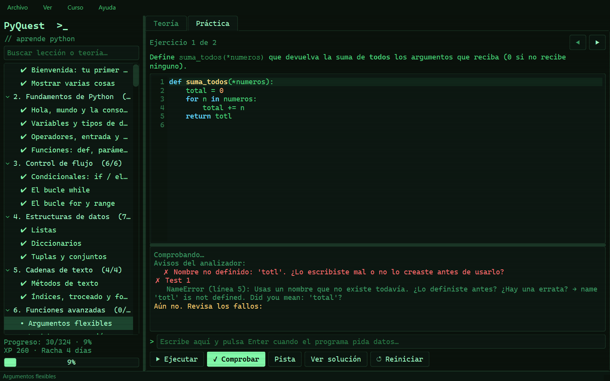
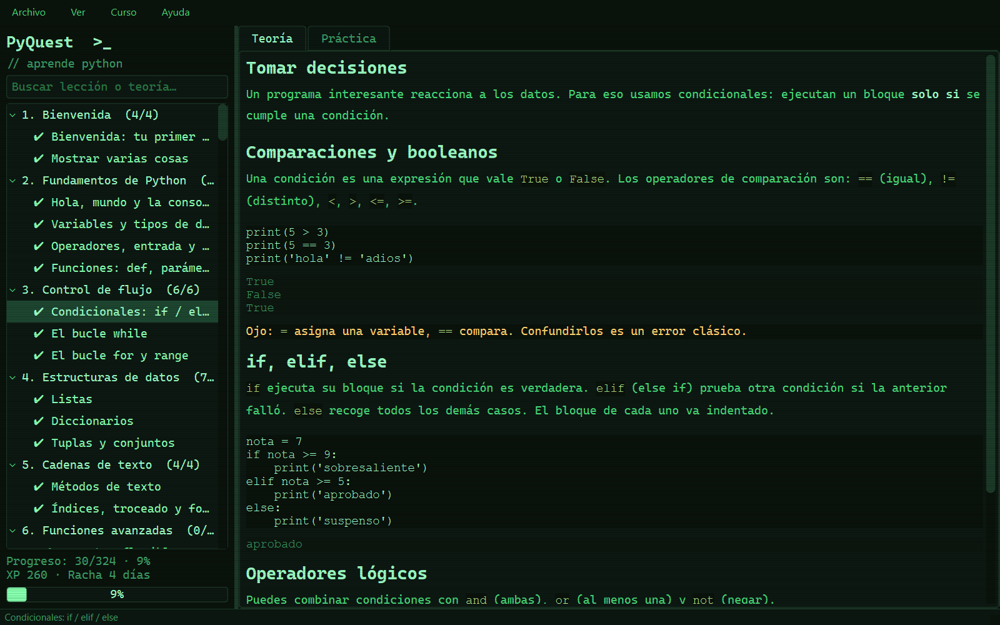
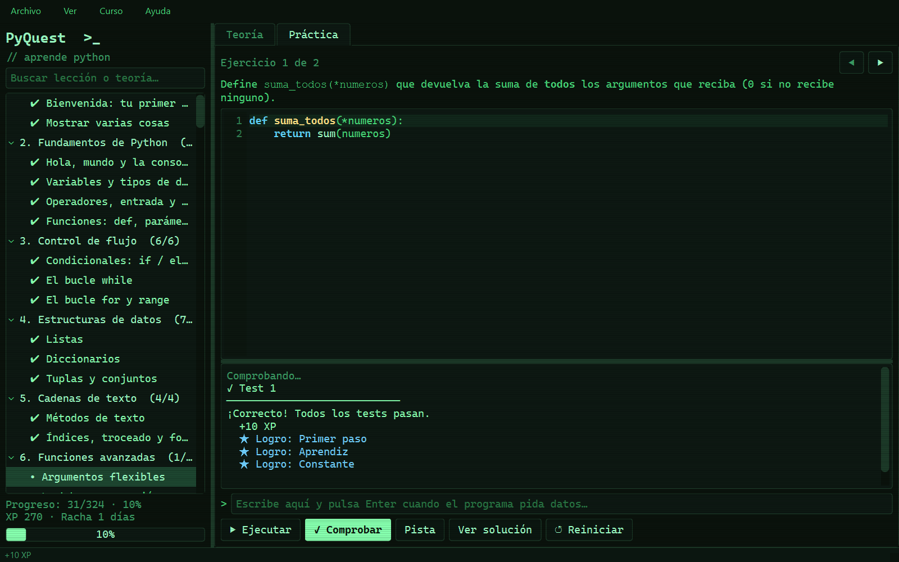
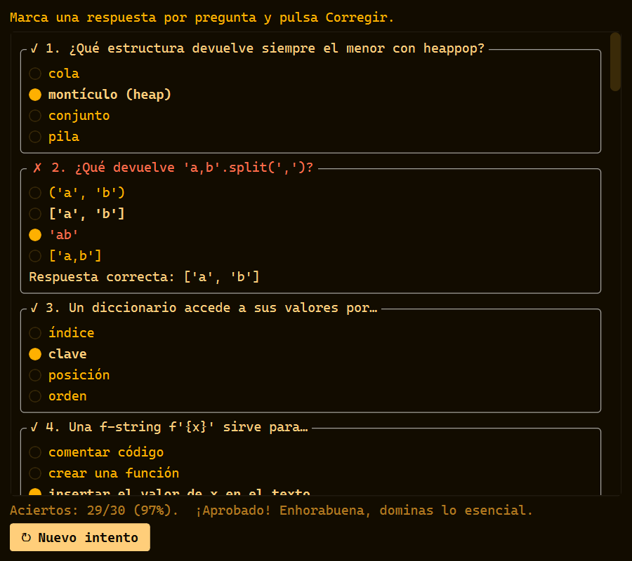

# PyQuest

[](LICENSE)


**Aprende Python con teoría + práctica, al estilo de una terminal retro.**
**Learn Python with theory + practice, retro-terminal style.**

PyQuest es una app de escritorio (tipo *MIMO / Duolingo* pero para programar) con un
núcleo teórico extenso y bilingüe (ES/EN) y una zona de práctica donde escribes
código real: la app lo **ejecuta**, lo **analiza** y te **explica los fallos** en
lenguaje claro. Interfaz sobria de terminal "fósforo verde".

*A desktop app to learn Python from zero to advanced: 79 modules, 161 lessons and 324
auto-graded exercises in Spanish and English. You write real code; PyQuest runs it,
analyses it and explains your mistakes in plain language.*



| Teoría / Theory | Ejercicio resuelto / Solved | Examen / Exam |
|:---:|:---:|:---:|
|  |  |  |

---

## 📥 Descargar / Download

Descarga la última versión desde **[Releases](../../releases/latest)** — no hace falta
tener Python instalado / *no Python install needed*:

| Sistema | Archivo | Notas |
|---------|---------|-------|
| Windows | `PyQuest-Setup-x.y.z.exe` (instalador) o `PyQuest.exe` (portable) | Al no estar firmado, Windows SmartScreen puede avisar: **Más información → Ejecutar de todas formas**. |
| macOS   | `PyQuest-x.y.z.dmg` | Firma *ad-hoc*: la primera vez, **clic derecho → Abrir**. |
| Linux   | `pyquest_x.y.z_amd64.deb` (Debian/Ubuntu) o el binario portable | `sudo apt install ./pyquest_x.y.z_amd64.deb` |

Tu progreso se guarda en la carpeta de datos del usuario (`%APPDATA%\PyQuest`,
`~/Library/Application Support/PyQuest` o `~/.local/share/PyQuest`) y se conserva al
actualizar.

---

## ✨ Características / Features

- **Teoría navegable** por módulos y lecciones, con ejemplos de código y salida esperada.
- **Práctica con corrección mixta**: análisis estático (sintaxis + *pyflakes*) **+**
  ejecución real en un **subproceso con sandbox** (sin red ni otros programas, escritura limitada al área de trabajo, *timeout* y tope de memoria de 2 GB) **+** tests por ejercicio.
- **Borradores automáticos**: el código que dejas a medias se guarda al cambiar de ejercicio o cerrar la app.
- **Sin trampas**: ver la solución está permitido, pero ese ejercicio ya no da XP.
- **Errores explicados**: traduce los *tracebacks* de Python (`NameError`, `IndexError`,
  `ZeroDivisionError`, …) a una explicación clara, y además muestra el traceback real.
- **Bilingüe ES/EN**: interfaz y contenido conmutables en caliente desde el menú *Ver → Idioma*.
- **Editor** con números de línea, resaltado de sintaxis, auto-indentado, **comentar con `Ctrl+/`** e **indentar/desindentar** la selección con `Tab`/`Mayús+Tab`.
- **Playground / zona libre** (*Ver → Playground*, `Ctrl+P`): escribe y ejecuta Python a tu aire, con `input()` en vivo.
- **Atajos de teclado**: `Ctrl+Intro` comprobar, `Ctrl+R` ejecutar, `Ctrl+J` siguiente pendiente, `Ctrl+F` buscar, `Ctrl+D` marcar, `Ctrl+P` Playground (lista en *Ayuda → Atajos*).
- **Progreso guardado** entre sesiones, con **barra de avance visual**, **panel de logros**,
  panel **Mi progreso** (con **gráfica de progreso**, desglose por módulo y ejercicios fallados), **marcadores (★)** de lecciones, **repaso de fallados** (*Ver → Repasar fallados*), **exportar/importar** progreso y reapertura de la **última lección** (con su tamaño de ventana); opción de **reiniciarlo** (menú *Archivo*).
- **Examen final (autoevaluación)** (*Curso → Examen final*): test de opción múltiple bilingüe, barajado en cada intento, que corrige **pregunta a pregunta** (y te enseña la respuesta correcta de las que falles); es solo para autoevaluarte (no es una certificación oficial).
- **4 temas** (verde fósforo, ámbar, MS-DOS azul y claro) con *scanlines* CRT sutiles (desactivables) e **icono propio**.
- **Multiplataforma**: ejecutables para **Windows, macOS y Linux (Debian/Ubuntu)**, con
  **firma de código** (ad-hoc en macOS por defecto; firma real documentada en `SIGNING.md`).

---

## 📚 Contenido / Curriculum

79 módulos (incl. Módulo 0 de bienvenida), 161 lecciones y 324 ejercicios corregidos automáticamente (bilingüe ES/EN):

0. **Bienvenida** — primeros pasos: qué es programar, cómo usar la app y tu primer `print`.
1. **Fundamentos** — print, variables y tipos, operadores e entrada, funciones.
2. **Control de flujo** — `if/elif/else`, bucle `while`, bucle `for` y `range`.
3. **Estructuras de datos** — listas, diccionarios, tuplas y conjuntos.
4. **Cadenas de texto** — métodos, índices, troceado y formato con f-strings.
5. **Funciones avanzadas** — valores por defecto, `*args`/`**kwargs`, lambdas, recursión.
6. **Errores y excepciones** — `try/except/else/finally` y `raise`.
7. **Programación orientada a objetos** — clases, objetos, herencia, `__str__`.
8. **Comprensiones e iterables** — comprensiones, `enumerate`, `zip`.
9. **Módulos y librería estándar** — `import`, `math`, `random`, `json`.
10. **Ficheros** — leer y escribir texto con `with open(...)`.
11. **Anotaciones de tipos** — type hints en variables, funciones y colecciones, `X | None`.
12. **Decoradores** — funciones de primera clase, closures y el decorador `@`.
13. **Generadores e iteradores** — `yield`, generadores perezosos y expresiones generadoras.
14. **Expresiones regulares** — buscar, extraer, sustituir y validar texto con `re`.
15. **Fechas y horas** — `datetime`, restar fechas, días de la semana y `strftime/strptime`.
16. **Hashing con `hashlib`** — resúmenes SHA-256, integridad, sal y contraseñas.
17. **Secretos y HMAC** — aleatoriedad segura con `secrets` y firmas con `hmac`.
18. **Codificación** — `str` vs `bytes`, UTF-8 y base64 (codificar no es cifrar).
19. **Validación y saneado** — validar tipo/rango/formato, sanear y listas blancas.
20. **Peligros: `eval`, `exec` y `pickle`** — inyección de código, `ast.literal_eval`, JSON seguro.
21. **Context managers (`with`)** — gestión de recursos, `__enter__`/`__exit__` y `@contextmanager`.
22. **Dataclasses** — `@dataclass`: init/repr/eq automáticos, defaults, métodos y `default_factory`.
23. **`collections`** — `Counter`, `defaultdict`, `deque` y `namedtuple`.
24. **`itertools` y `functools`** — `chain`, `combinations`, `reduce` y memoización con `lru_cache`.
25. **Enumeraciones (`Enum`)** — constantes con nombre, `auto()`, búsqueda por valor e iteración.
26. **Rutas con `pathlib`** — `name`/`stem`/`suffix`, `with_suffix` y `parts`.
27. **Bases de datos (`sqlite3`)** — SQL en memoria: CREATE/INSERT/SELECT, WHERE, ORDER BY y parámetros `?`.
28. **Ficheros CSV** — leer y escribir con el módulo `csv` e `io.StringIO`.
29. **Matemáticas y estadística** — `math` (gcd, factorial) y `statistics` (mean, median).
30. **Recursión** — caso base y caso recursivo: factorial, suma, potencia.
31. **Algoritmos** — búsqueda lineal/binaria y ordenación burbuja/inserción (nociones de O()).
32. **Bases numéricas y bits** — binario/hexadecimal y operadores de bits (`&`, `|`, `^`, `<<`, `>>`).
33. **Pilas y colas** — pila (LIFO), cola (FIFO) con `deque` y aplicaciones (paréntesis, historial).
34. **Conjuntos a fondo** — intersección, unión, diferencia, subconjunto y quitar duplicados.
35. **Diccionarios a fondo** — `get`, contar, invertir, fusionar y comprensiones de dict.
36. **Funciones de orden superior** — `map`, `filter` y `sorted` con `key`.
37. **Excepciones personalizadas** — crear excepciones, `raise`, jerarquías y captura por clase padre.
38. **Iteradores** — protocolo `__iter__`/`__next__`, `StopIteration`, `iter()` y `next()`.
39. **Decimal y Fraction** — aritmética exacta para dinero y fracciones racionales.
40. **Algoritmos: divide y vencerás** — `mergesort` y `quicksort` recursivos.
41. **POO: propiedades** — `@property` para atributos calculados y setters con validación.
42. **POO: métodos de clase** — variables de clase, `@staticmethod` y `@classmethod`.
43. **POO: herencia y polimorfismo** — `super()`, `isinstance`, sobreescritura y duck typing.
44. **Programación funcional** — closures con `nonlocal`, `functools.partial`, composición y `reduce`.
45. **Grafos** — grafo como diccionario; DFS, BFS y existencia de camino.
46. **Árboles binarios** — recorridos inorden/preorden, altura y conteo de nodos.
47. **Registro (`logging`)** — niveles, `getLevelName`, handlers y formatters.
48. **Línea de comandos (`argparse`)** — `add_argument`, `parse_args`, `type`, `default` y banderas.
49. **Pattern matching (`match/case`)** — literales, patrón `|`, comodín `_`, guardas y secuencias (Python 3.10+).
50. **Pattern matching avanzado** — desestructurar listas, diccionarios y clases (dataclasses).
51. **Programación asíncrona** — corutinas `async`/`await`, `asyncio.run` y `asyncio.sleep`.
52. **Concurrencia con `asyncio`** — `gather`, `create_task` y `wait_for` (timeouts).
53. **Atributos y `__slots__`** — `getattr`/`setattr`/`hasattr` y objetos ligeros con `__slots__`.
54. **Descriptores** — `__get__`/`__set__`/`__set_name__`: la maquinaria detrás de `@property`.
55. **Metaclases** — clases como objetos, `type()`, `__init_subclass__` y metaclases.
56. **Tipado avanzado** — `TypeVar`, `Generic`, `Protocol` (`runtime_checkable`) y uniones `X | None`.
57. **Hilos y concurrencia** — `threading.Thread`, `Lock` y `ThreadPoolExecutor`.
58. **Redes e IPs** — `ipaddress`: pública/privada, versión, subredes (CIDR) e IP como entero.
59. **Sobrecarga de operadores** — métodos dunder (`__repr__`, `__eq__`, `__len__`, `__add__`, `__getitem__`, `__contains__`).
60. **Montículos (`heapq`)** — `heappush`/`heappop`, `nsmallest`/`nlargest` y colas de prioridad.
61. **Búsqueda ordenada (`bisect`)** — `bisect_left/right`, `insort` y clasificación por intervalos.
62. **Formato de cadenas** — decimales, miles, porcentajes, anchura y alineación.
63. **`itertools` avanzado** — `accumulate`, `product`, `groupby` y `takewhile`.
64. **Matrices** — listas de listas: transponer (`zip*`), sumar, diagonal y aplanar.
65. **Aleatoriedad reproducible** — `random.seed`, `randint`, `choice` y `shuffle`.
66. **Algoritmos clásicos** — primos, palíndromos y anagramas.
67. **Regex avanzado** — grupos con nombre, backreferences en `sub`, `findall` y límites de palabra.
68. **Fechas avanzadas** — `timedelta` y zonas horarias con desfase fijo (`timezone`, `astimezone`).
69. **Bytes y `struct`** — `int`↔`bytes` (`to_bytes`/`from_bytes`) y empaquetado binario.
70. **Configuración (INI)** — `configparser`: secciones, claves, `getint` y valores por defecto.
71. **Pruebas (testing)** — `assert`, `unittest`, esperar excepciones y comparar con tolerancia.
72. **`contextlib` avanzado** — `suppress`, `redirect_stdout`, `ExitStack` y `closing`.
73. **Enum avanzado** — `IntEnum` (ordenable), métodos en `Enum` y `Flag` (combinar con bits).
74. **`functools` a fondo** — `total_ordering`, `singledispatch`, `cached_property` y `wraps`.
75. **Programación dinámica** — escalera, cambio de monedas, LCS y Kadane.
76. **Estructuras desde cero** — lista enlazada y tabla hash con cubos.
77. **Proyecto: análisis de texto** — frecuencias, ranking y estadísticas.
78. **Proyecto: mini-banco** — POO + excepciones: cuentas, movimientos y transferencias.

Todo el contenido es JSON editable: ampliarlo no requiere tocar el código (ver más abajo).

---

## 🚀 Ejecutar en desarrollo / Run from source

Requisitos: **Python 3.10+** (por el pattern matching `match/case` y `asyncio` moderno).

```bash
# 1) crear entorno e instalar dependencias
python -m venv .venv
source .venv/bin/activate        # Windows: .venv\Scripts\activate
pip install -r requirements.txt

# 2) lanzar la app
python run.py
```

O instálala como paquete desde la carpeta del repositorio, con el comando `pyquest`:

```bash
pip install .
pyquest
```

> En **Linux** la app necesita las librerías gráficas del sistema (normalmente ya
> presentes en un escritorio). Si faltara alguna:
> `sudo apt install libegl1 libxkbcommon0 libgl1`

---

## 🛠️ Generar los ejecutables / Build the executables

PyInstaller **no** compila para otros sistemas operativos de forma cruzada: cada
ejecutable se genera **en su propio SO**. Hay un script por plataforma:

| Sistema | Comando | Resultado |
|---------|---------|-----------|
| Linux   | `bash build/build_linux.sh`   | `dist/PyQuest/PyQuest` |
| macOS   | `bash build/build_macos.sh`   | `dist/PyQuest.app` |
| Windows | `build\build_windows.bat`     | `dist\PyQuest\PyQuest.exe` |

Por defecto usan `PyQuest.spec` (modo **one-dir**): el resultado es una **carpeta**
`dist/PyQuest/` que contiene el ejecutable + sus archivos. Arranca rápido, pero para
moverla a otro equipo hay que copiar la **carpeta entera** (no solo el `.exe`).

### Un solo archivo portable (one-file)

Si quieres **un único archivo** que puedas copiar suelto entre equipos del mismo SO,
compila con `PyQuest-onefile.spec` pasando `onefile` al script:

| Sistema | Comando | Resultado (un archivo) |
|---------|---------|------------------------|
| Linux   | `bash build/build_linux.sh onefile`  | `dist/PyQuest` |
| macOS   | `bash build/build_macos.sh onefile`  | `dist/PyQuest` |
| Windows | `build\build_windows.bat onefile`    | `dist\PyQuest.exe` |

Compromiso: el one-file se **auto-extrae** en una carpeta temporal al ejecutarse, así
que arranca y corre el código algo más lento que la versión one-dir, y el archivo es
más grande (incluye Qt). Para uso diario, one-dir; para llevar un solo archivo, one-file.

### Instaladores (accesos directos + desinstalador)

| Sistema | Comando | Resultado |
|---------|---------|-----------|
| Windows | `build\make_installer_windows.bat` | `dist\PyQuest-Setup-1.1.0.exe` — instalador clásico (menú Inicio, icono de escritorio, desinstalador). Requiere [Inno Setup](https://jrsoftware.org/isdl.php). |
| macOS   | `bash build/make_dmg.sh`            | `dist/PyQuest-1.1.0.dmg` — se abre y arrastras PyQuest a *Aplicaciones*. |
| Linux   | `bash build/make_deb.sh`            | `dist/pyquest_1.1.0_amd64.deb` — `sudo apt install ./dist/pyquest_1.1.0_amd64.deb` |

El `.deb` añade el lanzador al menú, el icono y el comando `pyquest` en la terminal, y
declara sus dependencias (Qt/EGL) para que `apt` las resuelva. El instalador de Windows
empaqueta la versión *one-dir*; el `.dmg` empaqueta `PyQuest.app`.

### Compilación automática para los 3 SO (GitHub Actions)

El workflow `.github/workflows/build.yml` compila Windows, macOS y Linux a la vez:

1. Sube el proyecto a un repositorio de GitHub.
2. Crea una etiqueta: `git tag v1.1.0 && git push --tags`
   *(o lánzalo a mano en la pestaña **Actions → build → Run workflow**).*
3. Descarga los tres ejecutables desde los *artifacts* del workflow.

---

## 📁 Estructura del proyecto / Project layout

```
pyquest/
├── run.py                     # lanzador de desarrollo
├── PyQuest.spec               # receta de PyInstaller
├── requirements.txt           # dependencias de ejecución
├── requirements-dev.txt       # + pyinstaller, pytest
├── build/                     # scripts de empaquetado por SO
├── docs/screenshots/          # capturas del README
├── .github/workflows/build.yml
├── tests/                     # pytest (motor, sandbox, progreso, contenido y GUI)
└── src/pyquest/
    ├── __main__.py            # punto de entrada (+ modo worker del ejecutable)
    ├── app.py                 # ventana principal
    ├── runner.py              # motor: análisis + ejecución + sandbox + tests + tracebacks
    ├── content.py             # carga y validación del contenido
    ├── course/                # TODA la teoría, ejercicios y examen (JSON)
    │   ├── modules.json
    │   ├── exam.json
    │   └── module_XX_*/{module.json, lesson_XX.json}
    ├── theme.py               # paleta y QSS "fósforo verde"
    ├── i18n.py                # textos de interfaz ES/EN
    ├── progress.py            # progreso del usuario (validado al cargar/importar)
    └── widgets/               # editor, consola, teoría, práctica, examen, barra lateral…
```

---

## ➕ Ampliar la teoría y los ejercicios / Add content

Todo el contenido vive en `src/pyquest/course/` como **JSON bilingüe**. No hay que tocar
el código. (Está dentro del paquete para que viaje con él al instalar con `pip` o al
compilar con PyInstaller.)

**Añadir una lección** a un módulo existente:

1. Crea `src/pyquest/course/module_01_fundamentos/lesson_05.json` (ver formato abajo).
2. Añádela a la lista `"lessons"` de ese `module.json`.

**Añadir un módulo nuevo**: crea la carpeta con su `module.json` y sus lecciones, y
añade el nombre de la carpeta a `src/pyquest/course/modules.json`.

### Formato de una lección

```jsonc
{
  "id": "m1l5",
  "title": { "es": "Mi lección", "en": "My lesson" },
  "theory": {
    "es": [
      { "type": "heading", "value": "Un título" },
      { "type": "text",    "value": "Un párrafo con **negrita** y `código`." },
      { "type": "code",    "value": ["x = 1", "print(x)"] },
      { "type": "output",  "value": ["1"] },
      { "type": "note",    "value": "Un aviso o truco." }
    ],
    "en": [ "...igual que arriba, en inglés / same, in English..." ]
  },
  "exercises": [
    {
      "id": "m1l5e1",
      "prompt": { "es": "Enunciado…", "en": "Task…" },
      "starter_code": ["def f(n):", "    pass"],
      "solution":     ["def f(n):", "    return n * 2"],
      "hints": { "es": ["Pista 1", "Pista 2"], "en": ["Hint 1", "Hint 2"] },
      "tests": [ /* ver tipos de test */ ]
    }
  ]
}
```

### Tipos de test

```jsonc
// 1) Comparar la salida por pantalla
{ "type": "stdout", "name": "saluda", "stdin": "Ana\n", "expected": "Hola, Ana!" }

// 2) Llamar a una función del usuario y comparar el valor devuelto
{ "type": "function", "function": "doble",
  "cases": [ { "args": [5], "expected": 10 }, { "args": [0], "expected": 0 } ] }

// 3) Arnés libre con asserts (lo más flexible; útil para tuplas, sets, etc.)
{ "type": "code", "harness": "assert minmax([4,1,7]) == (1, 7)" }
```

> Los textos largos (código, salida) se guardan como **listas de líneas** para que el
> JSON sea legible y no haya que escapar saltos de línea.

Comprueba que todo está bien con los tests incluidos:

```bash
pip install -r requirements-dev.txt
pytest -q          # valida el esquema y que cada solución pasa sus propios tests
```

---

## 🧠 Cómo funciona la corrección / How grading works

Cuando pulsas **Comprobar**, `runner.py` hace, en este orden:

1. **Análisis estático** con `compile()` (sintaxis) y `pyflakes` (nombres no definidos,
   imports sin usar…). Si hay un error de sintaxis, **no** se ejecuta nada.
2. **Ejecución real** del código en un **subproceso aislado** con *timeout* (un bucle
   infinito no congela la app: se detiene y se avisa).
3. **Tests** del ejercicio (salida, función o arnés con asserts).
4. Si algo falla, se **traduce la excepción** a una explicación clara (con la línea de
   **tu** código, no la de la librería estándar) y se muestra también el traceback original.

En los ejecutables (PyInstaller, *one-dir*) la app se relanza a sí misma con la bandera
`--run-user-script` para ejecutar el código del usuario, así que **no** necesita un
Python aparte instalado. En desarrollo se usa exactamente el mismo *worker*.

### Sandbox y límites

El código del alumno corre en un proceso aparte que, antes de empezar:

- **limita la memoria a 2 GB** (Windows: *Job Object*; Linux: `RLIMIT_AS`) y el tamaño
  de los ficheros que escribe (Linux/macOS);
- **no puede crear procesos** (`subprocess`, `os.system`, `os.startfile`, `multiprocessing`…;
  en Windows además lo impide el propio *Job Object*);
- **no puede conectarse fuera de la máquina** (sí a `127.0.0.1`, que `asyncio` necesita);
- **solo escribe dentro de su carpeta temporal** (`open`, `pathlib` y `tempfile`).

> ⚠️ Es una protección de **mejor esfuerzo** pensada para evitar accidentes de quien
> aprende (un bucle infinito, una lista gigante, escribir donde no debe), **no** una
> barrera de seguridad frente a código malicioso: por ejemplo, no impide leer ficheros
> ni borrarlos con `os.remove`.

---

## ⌨️ Tecnologías / Tech

Python 3 · PySide6 (Qt) · pyflakes · PyInstaller.

## 📄 Licencia / License

MIT — ver [LICENSE](LICENSE).
